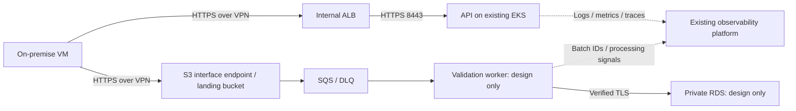

# Task 1: hybrid integration architecture

**Scope.** Assume private EKS workers across at least two availability zones,
VPN routing, private DNS, PKI, AWS Load Balancer Controller, enforced network
policies, Argo CD and observability already exist. This repository implements the
API network boundary and a sample API; batch processing is design-only.

**Mode A: real-time API.** The on-premise VM initiates HTTPS over redundant IPsec
Site-to-Site VPN tunnels to a private API hostname. Route tables exchange approved
prefixes; conditional DNS forwarding uses Route 53 Resolver inbound endpoints.
An internal ALB accepts TCP 443 from the approved on-premise CIDR, terminates TLS
1.2+ using an ACM certificate, and forwards HTTPS to EKS pod IPs on 8443.
Terraform security groups and Kubernetes network policies restrict access.
Only `/v1/reference/` is exposed through the ingress; probes and metrics stay internal.

The target uses short-lived machine tokens from the organisation's IdP. The API
would validate issuer, audience, expiry and `reference:read` authorization, failing
closed on invalid tokens. Current code only checks a shared Secret-backed token;
per-client identity and scope checks are not implemented. Platform PKI owns backend
TLS certificates. ALB encrypts backend traffic without validating target
certificates; use an additional verified proxy/mesh if backend identity is required.

**Mode B: nightly CSV.** An on-premise agent waits for an atomically completed
file, computes SHA-256 and uploads over HTTPS/VPN through an S3 interface endpoint.
No inbound internet connection to the VM is needed. IAM Roles Anywhere exchanges
organisation-issued certificates for short-lived, prefix-scoped upload credentials.
Endpoint and bucket policies enforce approved identity, TLS and SSE-KMS.
S3 events enter SQS; an EKS worker validates schema, types and file limits,
quarantines invalid inputs and loads valid rows into private RDS PostgreSQL over
verified TLS. Workload identity scopes AWS permissions; Secrets Manager supplies
rotated database credentials. Batch IDs, content hashes, uniqueness constraints
and database transactions make retries idempotent. Backoff and a DLQ isolate
failures; the source retains files until acknowledgement and retention expiry.

**Trade-offs.** VPN is economical but depends on internet transport; Direct Connect
with an encrypted overlay is an alternative for predictable throughput. S3/SQS
supports replay and decoupling, with duplicate events and eventual processing to
handle. Request/trace IDs and batch IDs correlate telemetry across boundaries.
Existing platform owners must provide verified telemetry TLS, access controls and
durable encrypted storage; local configuration does not verify these controls.

